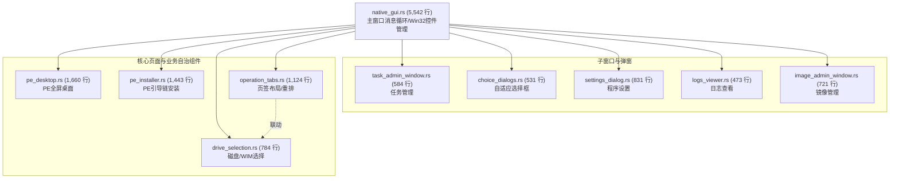

# native_gui 解耦之操作页签与驱动选择器抽离 (v2.7.5)

> **时点**：2026-11-02 20:40  
> **基准**：v2.7.5（模块化重构，接口与对外行为不变，版本保持 2.7.5）  
> **模型**：Gemini  
> **验证**：`./build-win.sh` 编译通过、`cargo test --workspace` 404 项全绿、`./tools/git-hooks/pre-push` 8 项门禁全绿、`tools/doc/stale-claims.sh` 扫描 STALE_HITS=0。

---

## 一、本次解耦工作概要

延续 `native_gui.rs` 巨石解耦演进路线，本次完成第四、第五两批次核心子系统抽离：

1. **抽离操作页签布局与切换控制器（[`operation_tabs.rs`](file:///Users/x/code/backupRestore/crates/backuprestore-cli/src/native_gui/operation_tabs.rs)，1,124 行）**：
   - 封装 5 大入口路由（A 还原系统至 C / B 还原数据 / C 新增第二系统 / PE 安装 / 备份）；
   - 封装系统盘、EFI 分区及当前程序所在卷安全判定（`active_system_letter`, `system_drive_letter`, `is_efi_system_partition`, `is_program_drive`）；
   - 封装页签实测文字算宽、控件排版布局（`layout_operation`, `layout_operation_tabs`, `fit_width`）；
   - 封装各操作页签引导文案提示与全局重绘。

2. **抽离驱动器与 WIM 选择控制器（[`drive_selection.rs`](file:///Users/x/code/backupRestore/crates/backuprestore-cli/src/native_gui/drive_selection.rs)，784 行）**：
   - 封装驱动器枚举、下拉框项填充、角色描述与详细参数格式化（`parse_drive_infos`, `set_drive_items`, `drive_display`, `drive_details`）；
   - 封装目标卷过滤视图安全换算（`target_combo_indices`, `select_drive`, `selected_drive_letter`）；
   - 封装 WIM 镜像索引列表解析、格式化与下拉框交互（`selected_wim_index`, `set_wim_items`, `wim_display`）；
   - 封装注册表 Windows 版本探测与备份索引名/引导菜单名智能生成（`prefill_menu_name_from_image`, `default_backup_index_name`, `refresh_backup_index_name`, `existing_boot_entry_names`）。

3. **巨石文件瘦身里程碑**：
   - `native_gui.rs` 从 7,425 行直接降至 **5,542 行**（净减 1,883 行）；
   - 相比于重构起点的 11,067 行，累计已净减 **5,525 行**（**代码量整整缩减 49.9%，巨石体积腰斩！**）。

---

## 二、当前 native_gui 模块体系全景

---

## 三、门禁与验收

1. **Windows 交叉编译（宿主机 ARM64 MSVC）**：
   - `./build-win.sh` 编译完成，产物 3,472,896 字节，0 编译警告。
2. **全工作区跨平台单元测试**：
   - `cargo test --workspace`：**404 项单测全绿**（backuprestore-cli 346 项 + backuprestore-core 58 项，0 failed）。
3. **Pre-push 8 项门禁全量通过**：
   - `./tools/git-hooks/pre-push`：8 项门禁全部放行。
4. **陈旧断言扫描**：
   - `./tools/doc/stale-claims.sh`：`STALE_HITS=0`，`RESULT=PASS`。
