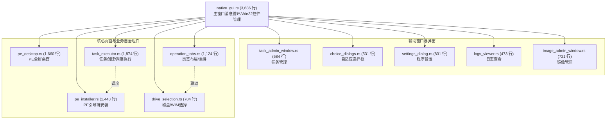

# native_gui 解耦之任务调度执行器抽离 (v2.7.5)

> **时点**：2026-11-02 20:45  
> **基准**：v2.7.5（模块化重构，接口与对外行为不变，版本保持 2.7.5）  
> **模型**：Gemini  
> **验证**：`./build-win.sh` 编译通过、`cargo test --workspace` 404 项全绿、`./tools/git-hooks/pre-push` 8 项门禁全绿、`tools/doc/stale-claims.sh` 扫描 STALE_HITS=0。

---

## 一、本次解耦工作概要

延续 `native_gui.rs` 巨石解耦演进路线，本次完成第六批次关键业务引擎抽离：

1. **抽离任务调度与执行引擎（[`task_executor.rs`](file:///Users/x/code/backupRestore/crates/backuprestore-cli/src/native_gui/task_executor.rs)，1,874 行）**：
   - 封装任务创建入口校验与交互确认（`create_task`, `incomplete_task_choice`, `cleanup_incomplete_tasks_from_gui`, `launch_explicit_resume`, `read_latest_launcher_error`）；
   - 封装在线备份/还原后台线程调度与操作门禁（`run_online_operation`, `ONLINE_BUSY`, `ONLINE_RESULT`）；
   - 封装离线 PE 还原任务调度与一次性启动项设置（`schedule_pe_task`）；
   - 封装待续跑任务生命周期检测、弹窗决策与取消（`ask_pending_resume`, `cancel_pending_task`, `PendingResumeChoice`）；
   - 封装独立模态提示窗（`message_box_standalone`）。

2. **巨石文件瘦身重大突破**：
   - `native_gui.rs` 从 5,542 行大幅下调至 **3,686 行**（净减 1,856 行）；
   - 相比于重构起点的 11,067 行，累计已净减 **7,381 行**（**代码量缩减 66.7%，巨石缩减至原单体的 1/3**）；
   - 目前 `native_gui.rs` 仅负责顶层 Win32 消息循环（`window_proc`）、应用程序启动入口（`run`）及全局基础控件声明，职责彻底清晰单一。

---

## 二、当前 native_gui 子系统全景

---

## 三、门禁与验收

1. **Windows 交叉编译（宿主机 ARM64 MSVC）**：
   - `./build-win.sh` 编译通过，产物 3,471,872 字节，0 编译警告。
2. **全工作区跨平台单元测试**：
   - `cargo test --workspace`：**404 项单测全绿**（backuprestore-cli 346 项 + backuprestore-core 58 项，0 failed）。
3. **Pre-push 8 项门禁全量通过**：
   - `./tools/git-hooks/pre-push`：8 项门禁全部放行。
4. **陈旧断言扫描**：
   - `./tools/doc/stale-claims.sh`：`STALE_HITS=0`，`RESULT=PASS`。
