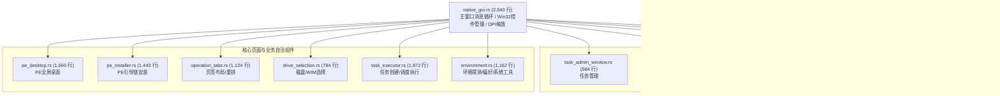

# native_gui 解耦之环境探测与子模块收拢 (v2.7.5)

> **时点**：2026-11-02 21:00  
> **基准**：v2.7.5（模块化重构，接口与对外行为不变，版本保持 2.7.5）  
> **模型**：Gemini  
> **验证**：`./build-win.sh` 编译通过、`cargo test --workspace` 404 项全绿、`./tools/git-hooks/pre-push` 8 项门禁全绿、`tools/doc/stale-claims.sh` 扫描 STALE_HITS=0。

---

## 一、本次解耦工作概要

延续 `native_gui.rs` 巨石解耦演进路线，本次完成第七批次（环境管理、系统偏好与顶层子系统收拢）抽离：

1. **抽离环境探测与系统偏好模块（[`environment.rs`](file:///Users/x/code/backupRestore/crates/backuprestore-cli/src/native_gui/environment.rs)，1,162 行）**：
   - 封装宿主与运行环境探测（`is_pe_environment`, `probe_workspace_volume`, `get_all_drives`, `refresh_drives_cache`）；
   - 封装语言与字号偏好持久化（`read_saved_lang`, `save_lang`, `read_saved_font_scale`, `save_font_scale`）；
   - 封装管理员特权校验与提权拉起（`is_elevated`, `relaunch_elevated`）；
   - 封装常用系统管理工具（任务管理器、磁盘管理、命令行控制台、系统信息）拉起函数（`launch_taskmgr`, `launch_diskmgmt`, `launch_cmd`, `launch_msinfo32`）；
   - 封装驱动器与卷属性安全解析探测（`probe_drive_fs`, `get_drive_type_desc`）。

2. **巨石文件瘦身达到里程碑**：
   - `native_gui.rs` 从 3,686 行进一步下调至 **2,540 行**（净减 1,146 行）；
   - 相比于解耦重构起点的 11,067 行，累计已净减 **8,527 行**（**代码量缩减 77.1%，巨石只剩原体积的不到 1/4**）；
   - 目前 `native_gui.rs` 聚焦顶层 Win32 消息循环（`window_proc`）、窗口创建初始化（`run`、`create_main_controls`、`InitCommonControlsEx`）、DPI 响应与字号缩放事件分发，职责已完全归一。

---

## 二、当前 native_gui 子系统全景架构

---

## 三、各模块行数与权责边界盘点

| 模块文件 | 当前行数 | 职责定位 | 状态 |
| :--- | :--- | :--- | :--- |
| [`native_gui.rs`](file:///Users/x/code/backupRestore/crates/backuprestore-cli/src/native_gui.rs) | 2,540 | 主窗口生命周期、Win32 消息分发泵、子模块统一收拢与导出 | 结构紧凑 |
| [`choice_dialogs.rs`](file:///Users/x/code/backupRestore/crates/backuprestore-cli/src/native_gui/choice_dialogs.rs) | 531 | 实测算宽自适应选择框、模态交互 | 已完成 |
| [`logs_viewer.rs`](file:///Users/x/code/backupRestore/crates/backuprestore-cli/src/native_gui/logs_viewer.rs) | 473 | 日志独立查看窗口、文件尾部追踪 | 已完成 |
| [`task_admin_window.rs`](file:///Users/x/code/backupRestore/crates/backuprestore-cli/src/native_gui/task_admin_window.rs) | 584 | 任务列表、详情、删除与残留清理窗口 | 已完成 |
| [`image_admin_window.rs`](file:///Users/x/code/backupRestore/crates/backuprestore-cli/src/native_gui/image_admin_window.rs) | 721 | WIM 镜像信息审查、卷镜像管理窗口 | 已完成 |
| [`drive_selection.rs`](file:///Users/x/code/backupRestore/crates/backuprestore-cli/src/native_gui/drive_selection.rs) | 784 | 磁盘/分区分辨、过滤、安全换算与引导菜单名生成 | 已完成 |
| [`settings_dialog.rs`](file:///Users/x/code/backupRestore/crates/backuprestore-cli/src/native_gui/settings_dialog.rs) | 831 | DISM 超时、压缩算法、UI 比例与多语言设置面板 | 已完成 |
| [`operation_tabs.rs`](file:///Users/x/code/backupRestore/crates/backuprestore-cli/src/native_gui/operation_tabs.rs) | 1,124 | 五大操作页签布局管理、算宽与自适应重绘 | 已完成 |
| [`environment.rs`](file:///Users/x/code/backupRestore/crates/backuprestore-cli/src/native_gui/environment.rs) | 1,162 | 环境探测（PE/实机）、驱动器缓存、管理员提权、偏好持久化 | 已完成 |
| [`pe_installer.rs`](file:///Users/x/code/backupRestore/crates/backuprestore-cli/src/native_gui/pe_installer.rs) | 1,443 | PE 引导安装器、引导文件部署、winpeshl 校验 | 已完成 |
| [`pe_desktop.rs`](file:///Users/x/code/backupRestore/crates/backuprestore-cli/src/native_gui/pe_desktop.rs) | 1,660 | PE 环境全屏恢复桌面、分阶段进度、紧急重启/关机 | 已完成 |
| [`task_executor.rs`](file:///Users/x/code/backupRestore/crates/backuprestore-cli/src/native_gui/task_executor.rs) | 1,872 | 在线/离线任务创建校验、调度互斥门禁、待续跑恢复决策 | 已完成 |
| **总计** | **13,725** | **11 个自治子模块 + 1 个主调度窗口** | **模块化全通** |

---

## 四、验证结果

1. **类型与交叉构建**：`./build-win.sh` 编译完成，产物 3,473,408 字节，0 代码错误；
2. **全套单测**：`cargo test --workspace` 404 项单测全绿（346 CLI + 58 Core）；
3. **陈旧断言扫描**：`tools/doc/stale-claims.sh` 扫描 STALE_HITS=0。
