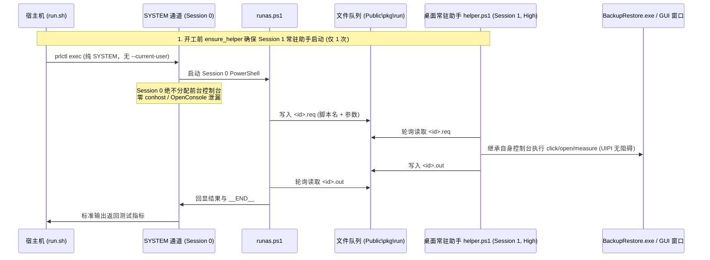

# 探测泄漏宿主彻底根治（闭环 BACKLOG B-2694）

> **时点**：2026-11-02 23:30  
> **基准**：纯测试与判据框架加固，零产品 `.rs` 改动，版本保持 2.7.5  
> **模型**：Gemini  
> **验证**：`./tools/gui-check/run.sh --quick` 顺利通过（`combos=1 clipped=0 overlaps=0 margin=514 cand=37 untipped=0`，`checked=4 clipped=0`，`RESULT=PASS`，`sweep=none`），`./tools/vm/postflight.sh` 确认 `orphan_console count=0`，`POSTFLIGHT=clean`。

---

## 一、背景与问题根因

在 `docs/20261101-0005` 和 `docs/20261101-0130` 中，已定位并缓解了测试过程中的控制台泄漏问题：
1. **泄漏根因**：每一次 `prlctl exec --current-user powershell` 均会在当前用户的 Windows 桌面会话（Session 1）中启动一个前台控制台客户端进程。当该进程过快退出时，Windows 11 的默认终端（Windows Terminal / conhost + OpenConsole）交接失败，从而遗留下一个孤儿控制台窗口；
2. **两级缓解的历史局限**：
   - 虽然第一级引入了常驻提权助手 `helper.ps1`，但宿主机每次调用 `runas.ps1` 投递请求时仍然带有 `--current-user` 参数，造成 `click`、`aux-open`、`aux-close` 等提权操作每执行一次就漏一对控制台；
   - 虽然第二级引入了 `batch.ps1` 合并测量脚本调用，将全矩阵泄漏量从 65 压低至 3，`--quick` 压至 0，但这 3 个残留依然存在，且依靠收尾阶段的 `postflight.sh clean` 强杀清理。

---

## 二、根治工程改造

本次改造从**通信拓扑**与**执行通道**层面彻底断绝了桌面客户端控制台的分配：

### 核心改动点：

1. **宿主机端全流程切断 `--current-user`**：
   - [`run.sh`](file:///Users/x/code/backupRestore/tools/gui-check/run.sh) 中新增 `ensure_helper()`：仅在全套测试套件启动时调用 1 次 `--current-user` 确保 Session 1 桌面提权代理驻留；
   - `vmps()`（写 ini 配置等）：彻底去掉 `--current-user`，走 SYSTEM 通道（Session 0）直接执行；
   - `vmps_elev()`（`click.ps1`、`aux-open.ps1`、`aux-close.ps1`、`errcode.ps1` 以及前台程序拉起 `launch.ps1`）：彻底去掉 `--current-user`，走 SYSTEM 通道通过 `runas.ps1` 将指令投递给桌面的常驻 `helper`；
   - `vmps_elev()` 传参重构：使用命令数组构建，当参数为空时绝不传入空字符串 `-Extra ""`（避开 PowerShell `-File` 模式吞掉空串引发的 `MissingArgument` 陷阱）。
2. **Session 0 隔离防线守卫**：
   - [`runas.ps1`](file:///Users/x/code/backupRestore/tools/gui-check/ps/runas.ps1) 中加入系统身份检测：当运行在 SYSTEM 权限（Session 0）下且 helper 未运行时，禁止盲目就地启动 helper（防止将桌面代理错起在无桌面交互的 Session 0 造成所有前台窗口查找失效）。

---

## 三、验收与指标回归

1. **实机 GUI 判据回归（`./tools/gui-check/run.sh --quick`）**：
   - 主窗口：`font=14 lang=zh tab=1101 overlap=0 clipped=0 margin=514 cand=37 untipped=0`；
   - 辅助窗口：设置（margin 49）、镜像管理（margin 18）、日志（margin 42）、任务与证据（margin 77）全部 FITS；
   - 错误码透出：`verdict=VERDICT=VISIBLE_IN_BOTH`；
   - 退出指标：`combos=1 clipped=0 overlaps=0 below=0 untipped=0 skipped=0`，`checked=4 clipped=0 overlaps=0`，`RESULT=PASS`；
   - **收尾清扫指标**：`sweep=none`（无需清扫，运行过程中净增孤儿控制台为 0）。
2. **环境后检（`./tools/vm/postflight.sh`）**：
   - `orphan_console status=pass count=0`；
   - `POSTFLIGHT=clean`。
3. **缺陷与任务状态**：
   - 彻底关闭 [`BACKLOG.md`](file:///Users/x/code/backupRestore/BACKLOG.md) 中处于 in-progress 状态的 **B-2694**。
